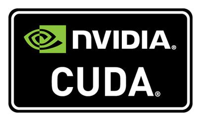

# Math Solver

<p align="center">
  
</p>

Math Solver helps you solve math problems step by step and practice what you
learn. The calculators, practice questions, formula reference and multiplication
tables work offline.

## Download

Get the **Android ARM64 APK** or the **Windows x64 ZIP** from the
[latest GitHub release](https://github.com/zminhquanz/MathSolver/releases/latest).

## Features

- **Solve Math.** Work through arithmetic, fractions, Find X, averages, powers
  and roots, and matrix calculations. Plot linear and quadratic equations,
  use diagrams to solve plane and solid geometry problems, and export large
  power results as TXT.
- **Math Puzzles.** Pick a topic or a mixed set, choose a difficulty from one
  to five stars, and answer true/false, multiple-choice or written questions.
  The app grades your work and shows the solution. A local AI model can
  optionally add question templates. See the [question bank guide](MathSolver/Services/QuestionBank/README.md).
- **Formulas and tables.** Look up formulas with worked examples, convert
  between units, and browse multiplication and division tables up to 20.
- **Interface and device tools.** Use the app in Vietnamese or English,
  customize its theme, fonts and wallpaper, and inspect CPU and memory
  information or run CPU benchmarks in **Settings → Hardware information**.

## Technology

Math Solver is built with C#, .NET 11, .NET MAUI 11, and XAML. The current
source includes hardware acceleration for large integer powers, matrix
calculations, and local language models.

- **Windows x86-64.** Power and matrix calculations can use SSE2, AVX2, and
  AVX-512 on compatible CPUs. The app labels its AVX2 mode **AVX/AVX2** because
  it also uses AVX for floating-point benchmarks.
- **Android ARM64.** Power and matrix calculations can use NEON (AdvSIMD).
  Compatible Android Release builds also offer SVE and SVE2 for selected
  operations on devices that expose 128-bit SVE vectors.
- **Local AI inference.** LLamaSharp and llama.cpp run GGUF models on the
  device. Android uses Arm KleidiAI on compatible ARM64 CPUs and a baseline
  CPU backend elsewhere. Windows can offload model layers to a compatible GPU
  through NVIDIA CUDA or Vulkan, with CPU fallback. See the [Android AI backend
  notes](MathSolver/Platforms/Android/Native/llama/README.md).

<!-- CUDA badge source: https://commons.wikimedia.org/wiki/File:Nvidia_CUDA_Logo.jpg -->
<p>
  <a href="https://github.com/SciSharp/LLamaSharp"></a>
  &ensp;
  <a href="https://developer.nvidia.com/cuda-zone"></a>
  &ensp;
  <a href="https://github.com/ARM-software/kleidiai"></a>
  &ensp;
  <a href="https://www.vulkan.org/"></a>
</p>

## Build from source

Install the .NET 11 SDK specified in [global.json](global.json) and the MAUI
workload for your target. For Android, install the Android SDK and use an
emulator or device. Build the Windows target on Windows.

```sh
git clone https://github.com/zminhquanz/MathSolver.git
cd MathSolver
```

| Target | Build command |
| --- | --- |
| Android | `dotnet build MathSolver/MathSolver.csproj -f net11.0-android` |
| Windows | `dotnet build MathSolver/MathSolver.csproj -f net11.0-windows10.0.26100.0` |

See [Build and distribution](MathSolver/ARCHITECTURE.md#build--distribution)
for the project layout, Android APK signing and build cleanup.

## Contributing

- For code changes, see the [architecture reference](MathSolver/ARCHITECTURE.md)
  and [test guide](UnitTest/README.md).
- To help translate the app, follow the [translation guide](TRANSLATING.md).

You can support Math Solver with an optional tip on [Ko-fi](https://ko-fi.com/quanvu96).

## License

The source code is licensed under the [GNU General Public License v3](LICENSE).
Copyright © 2026 Quan Vu.

Independent reuse of the Math Solver name, app icon, logo, screenshots or other
original branding requires written permission from the project author.
Forks and modified distributions must use their own name and branding unless
the author grants written permission.
